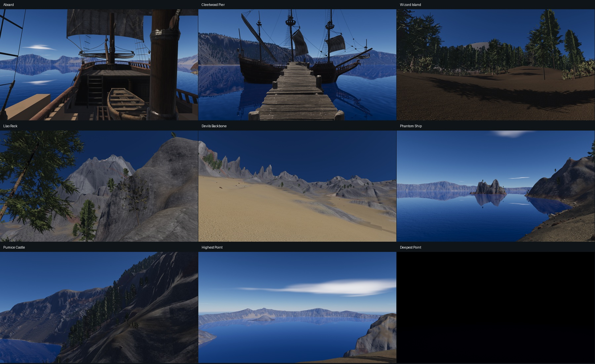

# Sojourney POI review — 2026-10-11

AMD WebGL2, 1600×900. Default weather and settings; no performance tuning.

- [Aboard](00-aboard.png)
- [Cleetwood Pier](01-cleetwood-pier.png)
- [Wizard Island](02-wizard-island.png)
- [Llao Rock](03-llao-rock.png)
- [Devils Backbone](04-devils-backbone.png)
- [Phantom Ship](05-phantom-ship.png)
- [Pumice Castle](06-pumice-castle.png)
- [Highest Point](07-highest-point.png)
- [Deepest Point](08-deepest-point.png)

Five landmark destinations now land on dry ground and face their landmarks. Boat, pier and extreme-height destinations retained. Pumice Castle remains hard to distinguish. Lowest-point view is black under the current sunlight attenuation at approximately 593 m depth.

Visible concerns: foliage patches, terrain boundaries/stepped bands, dark cliff/forest areas and jagged reflection edges. Appearance acceptance remains open.
